<div align="center">

# 🔬 Dual-Band Terahertz Metamaterial Absorber with Enhanced Sensing Capabilities

### A tiny, engineered "sensor chip" that can detect minute changes in a material by how it absorbs terahertz light


**Sai Vidya Institute of Technology, Bengaluru** · Department of Electronics & Communication Engineering

[📄 Read the Paper](paper/SCPGCON_Paper.pdf) · [🏅 View Certificate](certificate/) · [📊 Jump to Results](#-key-results-at-a-glance)

</div>

---

## 📌 TL;DR (30-second version)

> We designed a microscopic, postage-stamp-sized pattern of metal (a **"metamaterial absorber"**) that **soaks up almost 100% of terahertz light at two specific frequencies**.
> Because those two "absorption notes" shift whenever a substance placed on top changes even slightly, the same structure doubles as an **ultra-sensitive, label-free sensor**, with potential use in **medical diagnostics and early disease detection**.
>
> 🎤 *Shortlisted and presented at the **IEEE SCPGCON 2026** conference.*

| ✅ What I built | ✅ Why it matters | ✅ How well it works |
|---|---|---|
| A dual-band terahertz absorber + sensor, designed and simulated in COMSOL | Low-cost, non-destructive, chemical-free detection of biological samples | **99.2 %** and **97.79 %** absorption · **2.8 THz/RIU** sensitivity |

---

## 📚 Table of Contents

1. [The Big Picture (no jargon)](#-the-big-picture-no-jargon)
2. [Key Concepts in Plain English](#-key-concepts-in-plain-english)
3. [How Our Design Works](#-how-our-design-works)
4. [Design & Specifications](#-design--specifications)
5. [Step-by-Step: How We Arrived at the Final Design](#-step-by-step-how-we-arrived-at-the-final-design)
6. [Key Results at a Glance](#-key-results-at-a-glance)
7. [Looking Inside: Electric & Magnetic Field Analysis](#-looking-inside-electric--magnetic-field-analysis)
8. [Which Metal Works Best?](#-which-metal-works-best)
9. [How Does It Compare to Other Work?](#-how-does-it-compare-to-other-work)
10. [Why This Work Matters](#-why-this-work-matters)
11. [Tools & Skills Demonstrated](#-tools--skills-demonstrated)
12. [Repository Structure](#-repository-structure)
13. [Publication & Conference](#-publication--conference)
14. [Team](#-team)

---

## 🌍 The Big Picture (no jargon)

Imagine you want to check whether a blood sample, a drop of saliva, or a tissue sample contains signs of disease. Today that usually means **adding chemical dyes or tags ("labels")**, waiting for a lab, and paying for expensive equipment.

**What if you could just shine an invisible light on the sample and read the answer from how it reflects?**

That's the idea behind this project.

- We use **terahertz (THz) waves**, a kind of invisible light that sits between microwaves and infrared. They are **safe for biological samples** (they don't damage cells like X-rays can) and are very sensitive to the "fingerprint" of materials.
- We designed a **tiny patterned surface** that acts like a **trap for terahertz light**: at two particular frequencies, almost *no* light is reflected back. It's all absorbed.
- When a sample is placed on top of that surface, those "trap frequencies" **shift slightly**. By measuring *how much* they shift, we can tell what the sample is made of or whether it has changed.

**In short: we built (in simulation) a very precise, very small, label-free sensing platform.**

---

## 💡 Key Concepts in Plain English

<table>
<tr>
<td width="30%"><b>🌈 Terahertz (THz) waves</b></td>
<td>Invisible light between microwaves (your Wi-Fi/oven) and infrared (your TV remote). Often called <i>"T-rays"</i>. Safe, non-ionizing, and great for detecting what a material is made of.</td>
</tr>
<tr>
<td><b>🧩 Metamaterial</b></td>
<td>A man-made surface whose <i>shape</i>, not its chemistry, gives it special powers. Think of it like a <b>carefully carved sponge</b>: the pattern of holes determines what it soaks up. Ours is made of tiny copper patterns on a base layer.</td>
</tr>
<tr>
<td><b>🕳️ Absorber</b></td>
<td>Something that <b>soaks up</b> light instead of reflecting it, like a black T-shirt vs. a mirror. A <i>"perfect"</i> absorber soaks up ~100%.</td>
</tr>
<tr>
<td><b>🎵 Resonance</b></td>
<td>Every structure has "favourite" frequencies at which it vibrates strongly, just like a wine glass that rings (or shatters) at one particular musical note. At resonance, our structure absorbs the most light.</td>
</tr>
<tr>
<td><b>2️⃣ Dual-band</b></td>
<td>It has <b>two</b> favourite frequencies instead of one. This gives two independent "readings", which makes sensing more reliable and versatile.</td>
</tr>
<tr>
<td><b>🔎 Refractive-index sensing</b></td>
<td>Every substance bends light by a certain amount (its refractive index). If the substance changes (e.g., a healthy cell vs. an unhealthy one), that number changes slightly. Our device detects this by watching the absorption frequency <i>move</i>, like a guitar string changing pitch when you tighten it.</td>
</tr>
<tr>
<td><b>🏷️ Label-free</b></td>
<td>No fluorescent dyes or chemical tags needed. This saves cost and time, and doesn't alter the sample.</td>
</tr>
</table>

### 📏 The three "report-card" numbers for any sensor

| Metric | Everyday analogy | What a higher number means |
|---|---|---|
| **Q-factor** (Quality factor) | How *sharp* a musical note is. A pure, clean tone vs. a muddy one | Narrower, cleaner absorption peak → easier to spot tiny changes |
| **Sensitivity (S)** (THz per RIU) | How far the "pitch" moves when the sample changes | Bigger shift for the same change → more sensitive sensor |
| **Figure of Merit (FOM)** | The overall score, combining sensitivity and sharpness | Better all-round sensor performance |

---

## ⚙️ How Our Design Works

The absorber is a **three-layer sandwich**, repeated thousands of times like tiles on a floor:

<div align="center">
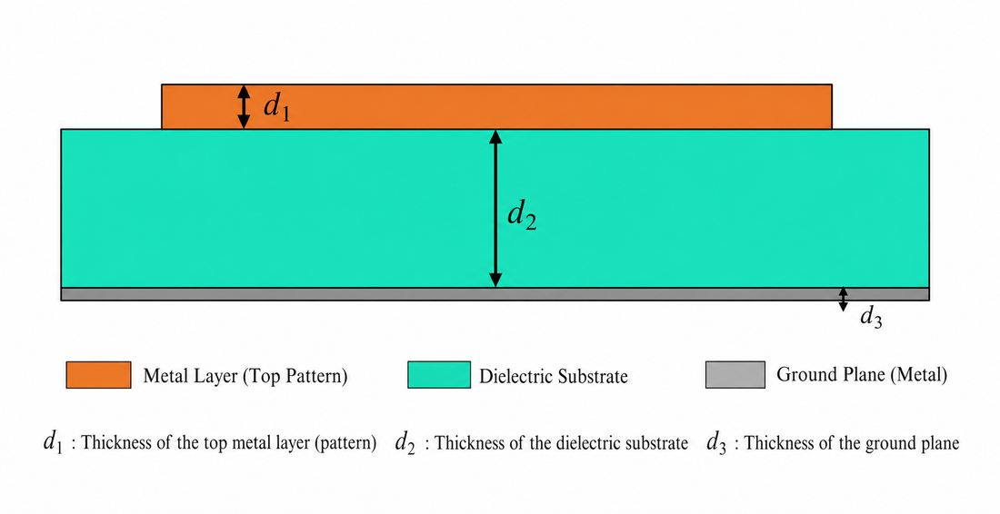

*Side view: patterned metal on top → insulating (dielectric) layer in the middle → solid metal mirror at the bottom.*
</div>

| Layer | Role (simple explanation) |
|---|---|
| **Top: patterned metal** (a square ring + a Z-shaped piece) | The "antenna" that catches the terahertz light. Its shape decides *which* frequencies get trapped |
| **Middle: dielectric spacer** | A transparent-ish cushion where the light energy gets trapped and turned into heat |
| **Bottom: solid metal sheet** | Acts as a mirror so *no* light passes through. Whatever isn't absorbed must bounce back, so we can measure it exactly |

**The core intuition:** Light that hits the surface can only do three things: reflect, pass through, or get absorbed. The bottom mirror blocks "pass through", and our patterned top layer is tuned so that **reflection is also nearly zero**, which leaves **absorption ≈ 100 %**:

```
Absorption  =  1  −  Reflection  −  Transmission
                              (Transmission ≈ 0 because of the mirror)
```

### 🧠 Why *two* shapes?

Instead of one complicated pattern, we combined **two simple ones**, each responsible for one "note":

- 🔲 **Square split-ring** → absorbs strongly near **0.73 THz**
- ⚡ **Z-shaped strip** → absorbs strongly near **0.94 THz**

When placed together, they **interact (couple)** with each other, which slightly shifts both notes and gives a clean **two-peak response**.

---

## 📐 Design & Specifications

<div align="center">
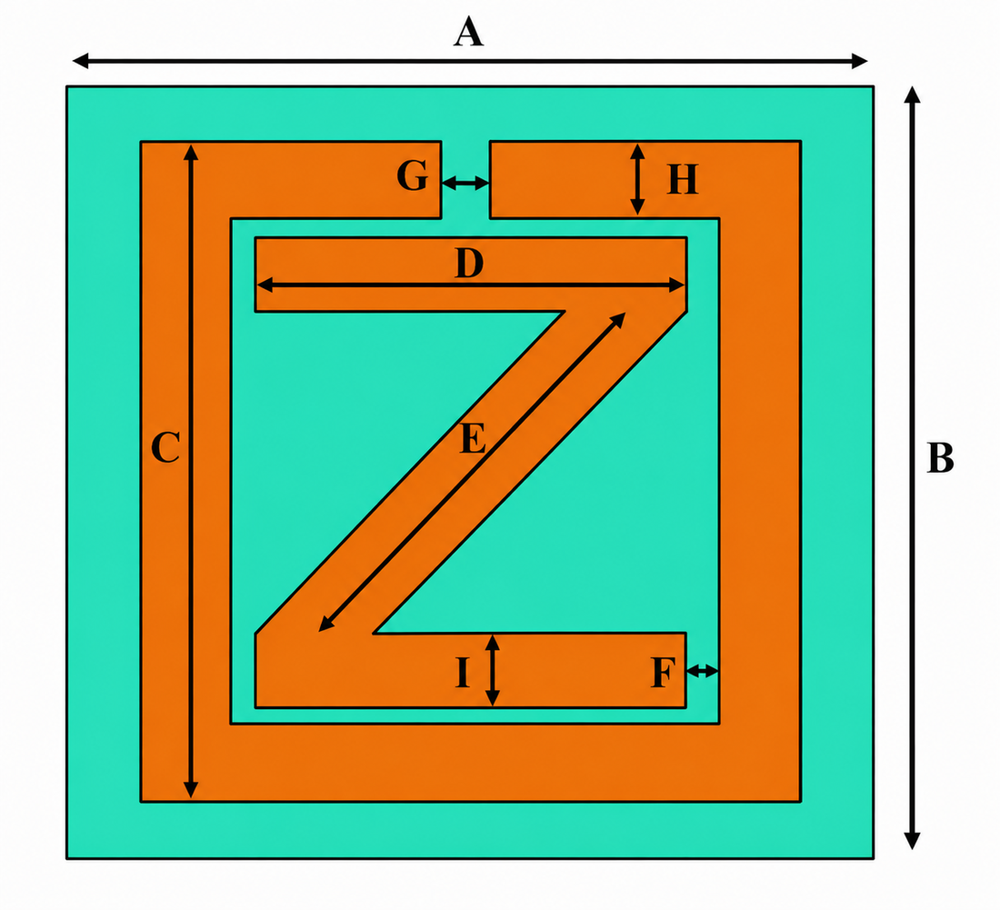

*Top view of a single "tile" (unit cell) of the absorber, with dimensions labelled.*
</div>

| Parameter | Meaning | Value |
|---|---|---|
| **A, B** | Overall tile size (period) | 50 µm × 50 µm |
| **C** | Outer square ring side | 40 µm |
| **D** | Horizontal bar of the "Z" | 26.5 µm |
| **E** | Diagonal bar of the "Z" | 31.6 µm |
| **F, G** | Gaps between sections | 2 µm |
| **H, I** | Strip widths | 5 µm |
| **Z angle** | Diagonal angle w.r.t. x-axis | 133.5° |
| **Top-layer material** | Patterned conductor | Copper (σ = 6.3 × 10⁷ S/m) |

> 📎 *1 µm (micrometre) = one-millionth of a metre. A human hair is ~70 µm wide, so more than one full tile fits across a hair's width!*

**Simulation setup:** Finite Element Method (FEM) in **COMSOL Multiphysics**, with periodic boundary conditions along x and y (to mimic an infinite repeating surface) and Perfectly Matched Layers (PMLs) along z (to absorb stray waves and avoid fake reflections).

---

## 🪜 Step-by-Step: How We Arrived at the Final Design

<div align="center">
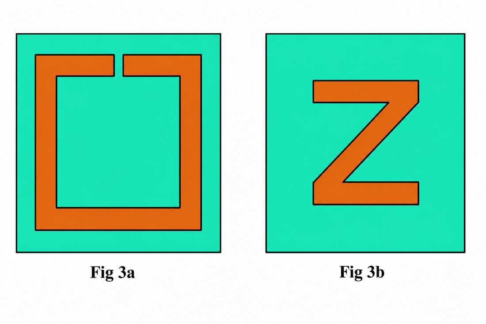

*Left: Design 1, the square split-ring. Right: Design 2, the Z-shaped resonator.*
</div>

### Step 1️⃣: Design 1 (Square Split-Ring): ~99.2 % absorption near 0.73 THz

<div align="center">
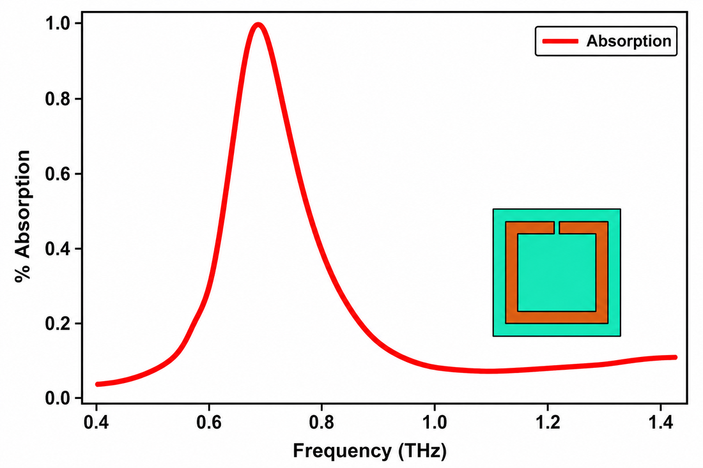
</div>

### Step 2️⃣: Design 2 (Z-Shape): ~96.7 % absorption near 0.94 THz

<div align="center">
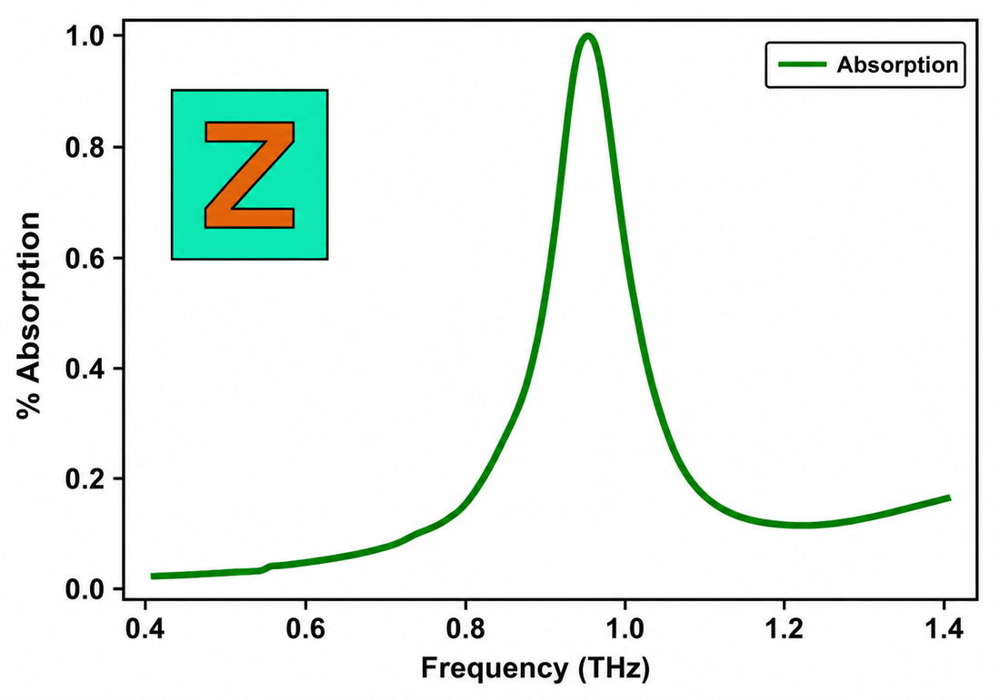
</div>

### Step 3️⃣: Combine both → Dual-band absorber 🎉

<div align="center">
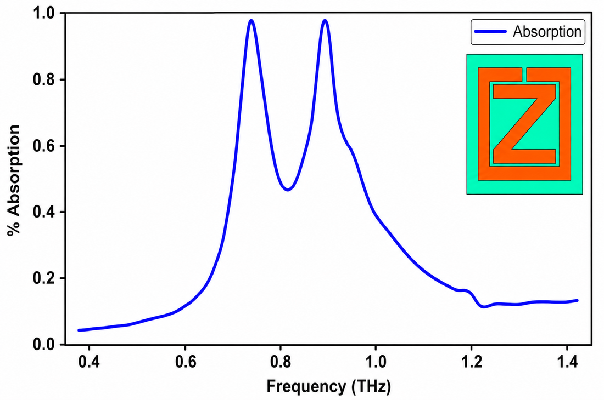

*Two sharp peaks: the "two notes" our sensor listens to.*
</div>

---

## 🏆 Key Results at a Glance

<div align="center">

| 🎯 Metric | Band 1 | Band 2 |
|:---|:---:|:---:|
| **Resonant frequency** | **0.7421 THz** | **0.9061 THz** |
| **Absorption** | **99.2 %** | **97.79 %** |
| **Bandwidth (FWHM)** | 0.0925 THz | 0.1502 THz |
| **Q-factor** (sharpness) | **8.0203** | **6.041** |

| 🧪 Sensing performance | Value |
|:---|:---:|
| **Sensitivity** | **2.797 – 2.801 THz/RIU** |
| **Figure of Merit (FOM)** | **18.63 – 30.28 RIU⁻¹** |

</div>

### ✨ Highlights in plain language

- ✅ **Near-perfect absorption** at *both* frequencies. Almost no light is wasted.
- ✅ **Works for both light polarisations** (TE and TM), so the sensor isn't picky about how the light is oriented.
- ✅ **Robust to angle changes**: stays reliable even if the light doesn't hit perfectly head-on, which is important for real-world setups.
- ✅ **Tunable**: a parametric study showed that tweaking dimensions moves the absorption peaks predictably, so the design can be adapted for different applications.
- ✅ **High sensitivity**: a very small change in the sample produces a large, easily measurable shift (~2.8 THz per unit change in refractive index).

---

## 🔍 Looking Inside: Electric & Magnetic Field Analysis

To *prove* why the device absorbs so well (and not just show that it does), we looked at the **electric field**, **magnetic field**, and the way energy concentrates inside a tile at each resonance. Red/yellow = very strong, blue = weak.

### ⚡ Electric field

<table align="center">
<tr>
<td align="center">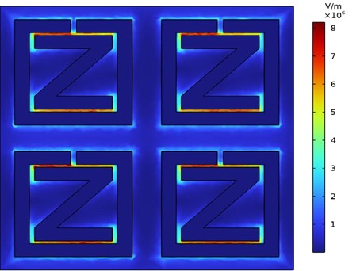<br/><b>At 0.7421 THz</b></td>
<td align="center">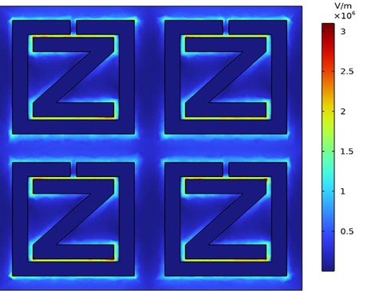<br/><b>At 0.9061 THz</b></td>
</tr>
</table>

### 🧲 Magnetic field

<table align="center">
<tr>
<td align="center">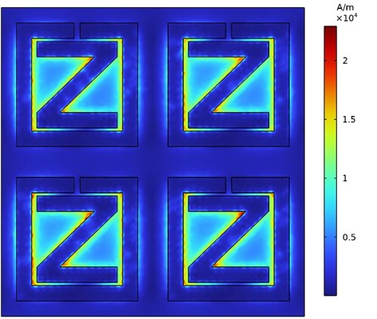<br/><b>At 0.7421 THz</b></td>
<td align="center">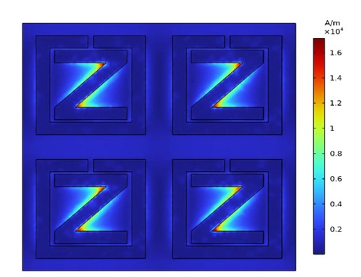<br/><b>At 0.9061 THz</b></td>
</tr>
</table>

**What this tells us (intuition):** at each resonance, the light's energy gets **squeezed into tiny hotspots along the edges and corners of the metal**, like water funnelled into a narrow channel. That concentrated energy is converted into heat inside the structure, which is exactly *why* so little light is reflected. These hotspots are also where a sample placed on top has the **strongest effect**, which is what makes the device a good sensor.

---

## 🪙 Which Metal Works Best?

The choice of metal strongly affects performance. We compared four.

<div align="center">
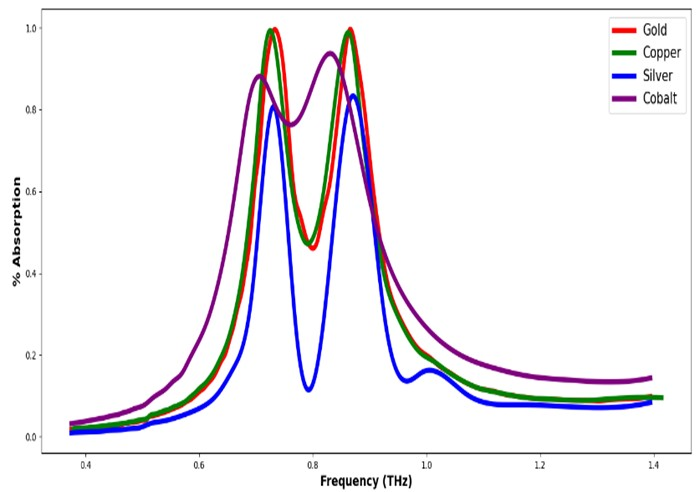
</div>

| Metal | Observation | Practical verdict |
|---|---|---|
| 🥇 **Gold** | Near-perfect absorption (~99.5 %), stable | Excellent, but **expensive** for large-scale use |
| ⚪ **Silver** | Sharpest peaks (Q ≈ 9.4) | Great performance, but **oxidises/tarnishes** over time |
| 🟠 **Copper** | High absorption (97–99 %), moderate Q | **Best balance of performance, scalability and cost** ✅ |
| 🔵 **Cobalt** | Low Q, broad peaks | Not suitable for precise biosensing |

We also explored a **copper–silver hybrid**, aiming to combine silver's sharp resonance with copper's durability and low cost.

---

## 📊 How Does It Compare to Other Work?

| Parameter | Ref. [15] | Ref. [16] | **This Work** |
|---|---|---|---|
| Absorber shape | Array of rings | Multilayer structure | **Ring + Z-shaped resonator** |
| Operating frequency | 4.5–5.6 THz | 4.5–5.6 THz | **0.74–0.91 THz** |
| Max. absorbance | 99 % | > 95 % | **98–99.5 %** |
| Q-factor | 8.948 | 5.359 | **8.0203** |
| Sensitivity | 3.880 THz/RIU | 429 GHz/RIU | **2.801 THz/RIU** |

**Takeaway:** our design reaches *comparable* absorption and sharpness to published work, while operating at a **much lower terahertz frequency (< 1 THz)**. Lower-THz devices are generally **easier and cheaper to work with** in practice. Compared with Ref. [16], we achieve **~6.5× higher sensitivity** and a **higher Q-factor**.

---

## 🚀 Why This Work Matters

| 🏥 Healthcare | 🔬 Research & Industry | 🌱 Broader impact |
|---|---|---|
| Potential for **early disease detection** (cancer, infections, etc.) by spotting tiny changes in tissue or fluids | **Label-free** testing cuts the cost, time, and chemicals normally needed | Compact, chip-scale devices could eventually enable **portable, low-cost diagnostics** |
| Non-ionising THz waves are **safe for biological samples** | Same principle applies to food safety, environmental monitoring, and security screening | A building block for next-gen **THz sensors, imaging, and 6G-era communication** hardware |

> 🧭 **The one-line pitch:** *Smaller, cheaper, faster and chemical-free sensing, built from nothing more than a carefully designed pattern of metal.*

---

## 🛠️ Tools & Skills Demonstrated

| Area | Details |
|---|---|
| **Simulation / EM Modelling** | COMSOL Multiphysics, Finite Element Method (FEM), periodic boundary conditions, PML |
| **Electromagnetics & Photonics** | Metamaterials, terahertz physics, impedance matching, S-parameters, resonance analysis |
| **Sensor Engineering** | Q-factor, sensitivity, FOM, refractive-index sensing |
| **Design Optimisation** | Parametric sweeps, material comparison, angle & polarisation robustness study |
| **Research & Communication** | Technical writing in IEEE format, peer-reviewed shortlisting, conference presentation |

---

## 📁 Repository Structure

```
📦 repo-root
 ┣ 📂 assets/        → Figures and graphs used in this README
 ┣ 📂 paper/         → Full conference paper (PDF)
 ┣ 📂 certificate/   → Conference presentation certificate
 ┗ 📄 README.md      → You are here
```

---

## 🎤 Publication & Conference

<div align="center">

### 🏅 Presented at the **2026 Smart RF Communication, Photonics, Geoscience and Remote Sensing Conference (SCPGCON)**
**Organised under IEEE**

</div>

This work was **successfully shortlisted** after review and **presented** at the conference.

| | |
|---|---|
| 📄 **Paper** | *Dual-Band Terahertz Metamaterial Absorber with Enhanced Sensing Capabilities* → [**Read the full paper (PDF)**](paper/SCPGCON_Paper.pdf) |
| 🏅 **Certificate** | [**View my presentation certificate**](certificate/SCPGCON_Certificate.pdf) |
| 📑 **Format** | IEEE conference paper · ISBN 979-8-3315-5173-5/26 |

### 📝 Citation

```bibtex
@inproceedings{scpgcon2026_thz_absorber,
  title     = {Dual-Band Terahertz Metamaterial Absorber with Enhanced Sensing Capabilities},
  author    = {Tejashree S and Chaya B M and Likith S and Chethan R},
  booktitle = {2026 Smart RF Communication, Photonics, Geoscience and Remote Sensing Conference (SCPGCON)},
  year      = {2026},
  publisher = {IEEE}
}
```

---

## 👥 Team

Department of Electronics & Communication Engineering, **Sai Vidya Institute of Technology**, Rajanukunte, Bengaluru, India.

| Name | Role |
|---|---|
| **Tejashree S** | Author |
| **Chaya B M** | Author |
| **Likith S** | Author |
| **Chethan R** | Author |

---

<div align="center">

⭐ *If you found this project interesting, consider giving the repo a star!* ⭐

*Made with curiosity, a lot of simulations, and many cups of coffee ☕*

</div>
